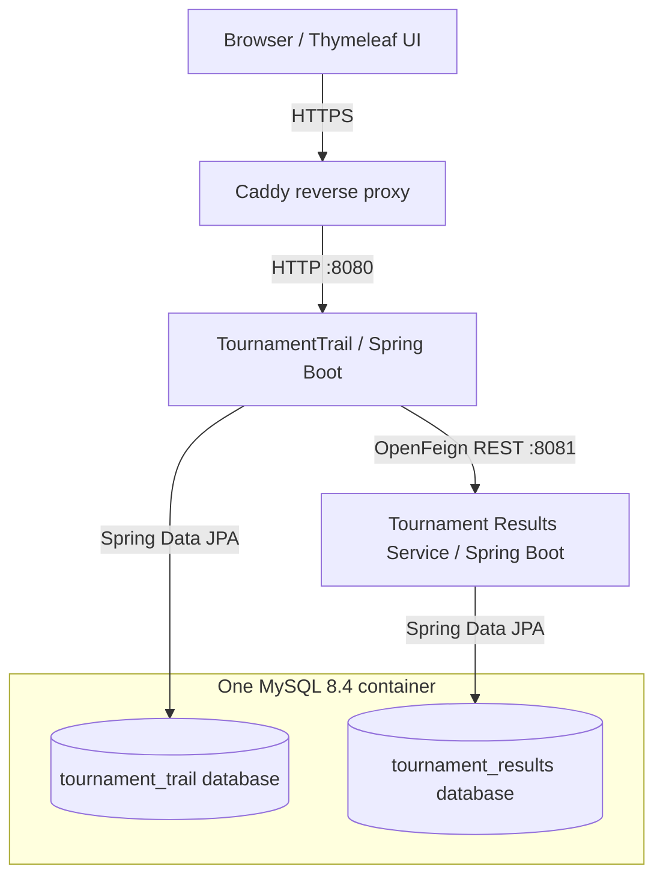

# TournamentTrail

**A Java/Spring Boot application for managing chess tournaments, player registrations, travel coordination, and game results.**

TournamentTrail is a personal backend-focused portfolio project built to practise designing real business workflows, modelling relational data, testing application behaviour, and deploying a multi-service system. It combines a server-rendered web application with a separately maintained REST microservice and a live Azure deployment.

**[Live demo](https://tournamenttrail.duckdns.org)** · **[Main application repository](https://github.com/pavlov95/tournament-trail)** · **[Tournament Results Service repository](https://github.com/pavlov95/tournament-results-service)**

> **Demo environment:** Sample tournaments and game results are fictional. Payment tracking represents a manual workflow; no real online payment gateway is integrated. The public demo runs on Azure for Students, so availability depends on the VM and remaining cloud credit.

## What the application does

| Area | Implemented functionality |
| --- | --- |
| Accounts & access | Registration, BCrypt password hashing, email verification with expiring tokens, login/logout, and `PLAYER`, `ORGANISER`, and `ADMIN` roles using Spring Security. |
| Tournaments | Create and edit tournaments, manage publication/cancellation, browse published upcoming tournaments and filter by name, location, time control, and rated status. |
| Player registrations | Register for tournaments, track registration and manual payment statuses, handle capacity limits, cancellations, and time-limited payment reservations. |
| Travel coordination | Create tournament-related travel groups, request to join, approve/reject requests, manage group details, and exchange comments. |
| Reviews | Leave, edit, and remove tournament reviews subject to business rules; display review summaries and ratings. |
| Game results | Use a separate REST service to create, update, delete, and retrieve chess games, and calculate tournament standings from recorded results. |
| User experience | Thymeleaf pages, server-side validation, English/Bulgarian localisation, and contextual navigation. |
| Background processing | Scheduled tournament-status updates and expiration of pending payment reservations. |
| Performance | Caffeine caching for selected tournament reads and search-related data, with cache eviction when tournament data changes. |

### Try the live demo

1. Open the [live application](https://tournamenttrail.duckdns.org) and browse the sample tournaments.
2. Create a test account and verify it using the email link if you want to explore authenticated features.
3. Explore tournament registrations, travel groups, reviews, and the game-results/standings pages where available.
4. Switch between English and Bulgarian using the language selector.

Some operations require a particular user role or ownership of a resource. The sample events are for demonstration only, not real registrations or payments.

## Architecture

The system is deployed on an **Azure Ubuntu virtual machine** using Docker Compose. Caddy handles HTTPS and forwards requests to the main Spring Boot application. The main application uses **OpenFeign** to communicate with the independently maintained Tournament Results Service over Docker's internal network.



- **Main application:** authentication, tournaments, registrations, travel groups, reviews, and Thymeleaf views.
- **Results microservice:** REST endpoints for chess games and calculated player standings, maintained in a [separate repository](https://github.com/pavlov95/tournament-results-service).
- **Data:** two logically separate MySQL databases hosted by one MySQL container, with a persistent Docker volume on Azure.
- **Networking:** Caddy exposes ports 80/443; the main application binds port 8080 to the VM's loopback interface, and the results service is accessible only inside the Docker network.
- **Monitoring foundations:** Spring Boot Actuator and Micrometer/Prometheus instrumentation are configured in the main application. A local Compose setup also includes Prometheus and Grafana; production monitoring and alerting are future work.

## Technology stack

| Layer | Technologies |
| --- | --- |
| Language & backend | Java 17, Spring Boot 3.4, Spring MVC, Spring Security, Spring Validation, Spring Scheduling |
| Persistence | Spring Data JPA, Hibernate, MySQL 8.4; H2 for tests |
| Service communication | Spring Cloud OpenFeign, REST/JSON |
| Frontend | Thymeleaf, HTML, CSS, Thymeleaf Security extras |
| Email & localisation | Spring Mail (SMTP), Spring internationalisation, English/Bulgarian message bundles |
| Caching & health | Spring Cache, Caffeine, Spring Boot Actuator, Micrometer |
| Testing | JUnit 5, Mockito, MockMvc, Selenium, Maven |
| Infrastructure | Docker, multi-stage Dockerfiles, Docker Compose, Caddy, Azure Ubuntu VM, DuckDNS |
| Automation | GitHub Actions, Maven CI, Azure OIDC federation, Azure VM Run Command |

## Engineering work demonstrated

This project has given me hands-on experience with more than basic CRUD operations:

- **Business rules and data modelling:** relational entities, UUID identifiers, DTOs, validation, JPA relationships, transactions, ownership checks, and domain-specific exceptions.
- **Authentication and authorisation:** Spring Security configuration, role/permission modelling, BCrypt, email verification tokens, and conditional page access.
- **Cross-service integration:** a dedicated results service with REST endpoints, Feign clients, independent persistence, and standings calculation.
- **Testing:** service-level unit tests with Mockito, MVC/API tests with MockMvc, Spring Boot integration tests using H2, and Selenium browser tests.
- **Operations and deployment:** containerised Java builds, environment-based configuration, persistent MySQL data, HTTPS reverse proxying, and remote VM deployment.
- **Performance and background tasks:** cache-aside-style application caching, invalidation rules, and scheduled state transitions.

## Testing and CI/CD

The main repository includes a GitHub Actions workflow in [`.github/workflows/ci.yml`](.github/workflows/ci.yml).

```text
Push to main
    |
    v
Maven clean verify (build + automated tests)
    |
    v
Azure login via OpenID Connect (OIDC)
    |
    v
Azure VM Run Command
    |
    v
Git update + Docker Compose rebuild of main application
    |
    v
Spring Boot health check
```

- Pull requests to `main` run the build-and-test job without deploying.
- A push to `main` deploys the **main TournamentTrail application only if the tests pass**.
- Azure authentication uses **OIDC federation** rather than a long-lived Azure client secret or a publicly accessible GitHub-to-VM SSH connection.
- The deployment script checks the application's `/actuator/health` endpoint and reports whether startup succeeded.
- **Current scope:** the Results Service is deployed separately; its deployment is not yet part of the main application's automatic CD pipeline.

Run the main project's tests locally with:

```bash
./mvnw clean verify
```

The Results Service also has its own unit and API tests, which can be run from its repository using the same Maven command. On Windows, use `mvnw.cmd` instead of `./mvnw`.

## Local development

### Prerequisites

- JDK 17
- MySQL 8.x
- Git
- Maven or the included Maven wrappers
- SMTP credentials for sending verification emails (for example, a Gmail app password)

### 1. Clone both repositories as sibling directories

```bash
git clone https://github.com/pavlov95/tournament-trail.git
git clone https://github.com/pavlov95/tournament-results-service.git
```

Expected layout:

```text
projects/
├── tournament-trail/
└── tournament-results-service/
```

### 2. Prepare MySQL

Create the databases `tournament_trail` and `tournament_results`, and grant your application database user access to both.

### 3. Configure environment variables

Set the following in your local shell or IDE run configuration:

```text
DB_USERNAME=<local_mysql_user>
DB_PASSWORD=<local_mysql_password>
MAIL_USERNAME=<smtp_username>
MAIL_PASSWORD=<smtp_password_or_app_password>
```

Do not commit credentials or your `.env` file. When starting Spring Boot directly from Maven/IntelliJ, environment variables must be made available to that process; Maven does not automatically load a Docker Compose `.env` file.

The main application defaults to `http://localhost:8080` for verification links and `http://localhost:8081` for the Results Service. Both are configurable through `APP_PUBLIC_URL` and `TOURNAMENT_RESULTS_URL`.

### 4. Start both services

Terminal 1:

```bash
cd tournament-results-service
./mvnw spring-boot:run
```

Terminal 2:

```bash
cd tournament-trail
./mvnw spring-boot:run
```

Open **http://localhost:8080**. The Results Service runs at **http://localhost:8081** and provides endpoints including:

```text
GET    /api/tournaments/{tournamentId}/games
POST   /api/tournaments/{tournamentId}/games
PUT    /api/tournaments/{tournamentId}/games/{gameId}
DELETE /api/tournaments/{tournamentId}/games/{gameId}
GET    /api/tournaments/{tournamentId}/standings
```

The repository also includes `compose.yaml` for a local Docker setup with optional Prometheus/Grafana services and `compose.azure.yaml` for the cloud deployment. The local Compose configuration expects MySQL on the host (`host.docker.internal`), so it is not a fully self-contained local database stack.

A profile-specific `DemoDataInitializer` can populate fictional users, tournaments, registrations, travel groups, reviews, and games. Its `demo` profile requires a configured demo organiser password; it is not enabled during normal application startup.

## Roadmap — what I plan to learn and implement next

I am prioritising improvements that address real limitations and deepen my backend engineering skills, rather than adding technologies solely for the sake of the stack.

**Next priorities**

1. **Stronger authorisation and security tests:** enforce server-side ownership/role checks on every game-result modification, expand negative-path security tests, and add protection against abuse of registration/login endpoints.
2. **Database migration management:** introduce Flyway or Liquibase, replace production reliance on `ddl-auto=update`, and practise repeatable schema changes and rollbacks.
3. **Reliable API and error handling:** improve duplicate-account feedback, validate more edge cases, and add timeouts and graceful handling when the Results Service is unavailable.
4. **Complete CI/CD for both repositories:** automate Results Service deployment, deploy the exact commit that passed CI, and add safer release/rollback procedures.
5. **Backups and observability:** schedule database backups, test restoration, and expand logs, metrics, dashboards, and alerting for the Azure deployment.

**Further development**

- Design and document a more complete versioned REST API with OpenAPI/Swagger.
- Learn Angular and incrementally build a separate frontend and role-specific dashboards while keeping the existing Thymeleaf application usable.
- Add pagination and more efficient queries for large tournament, registration, user, and travel-group datasets.
- Expand integration, end-to-end, and cross-service contract tests.
- Improve email notifications for registration, payment-status, travel-group, and tournament changes.
- Evaluate a distributed cache such as Redis **if** real multi-instance or performance requirements justify it.

## Current limitations

TournamentTrail is a **learning and portfolio deployment**, not a commercial tournament or payment-processing platform. Its current limitations include manual payment handling, Hibernate-managed schema updates, a single Azure VM, non-automated deployment of the Results Service, and further security hardening and recovery automation still on the roadmap. Demo content should not be treated as real events.

---

**Built to demonstrate practical Java/Spring development, automated testing, service integration, and cloud deployment — with a clear plan to improve the system based on what the implementation needs next.**

